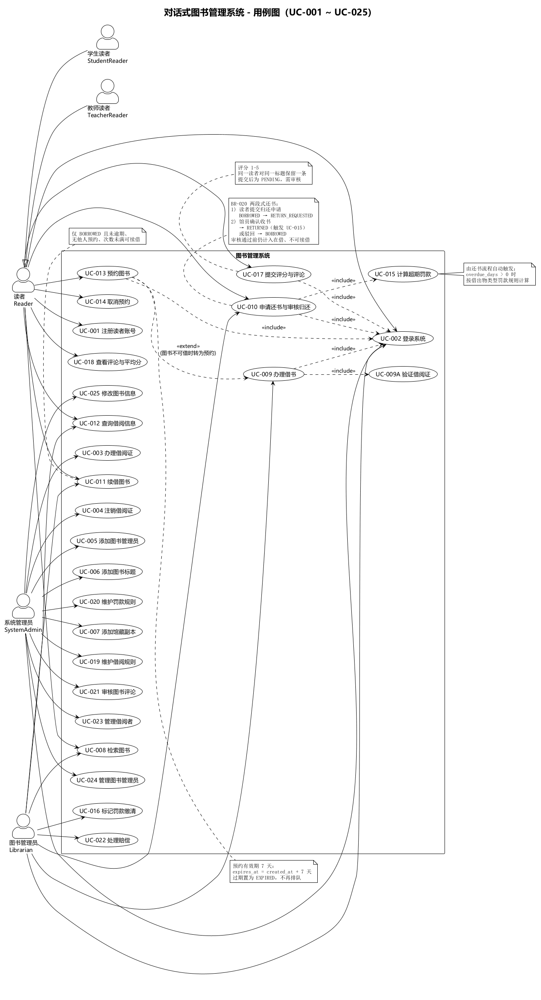
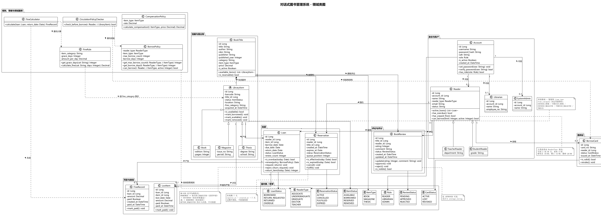
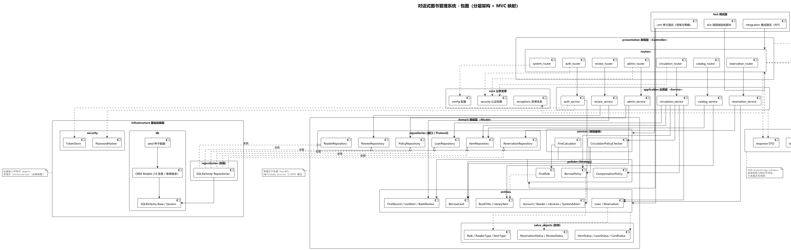

# AI 时代《软件设计与体系结构》实验报告（实验一）

## 对话式图书管理系统的架构设计与 Spec 建模

| 项目 | 内容 |
|---|---|
| 课题 | 对话式图书管理系统（Spec-Driven + Agent 辅助实现） |
| 姓名 / 学号 | 王文硕/1024005279 |
| 班级 | 软件卓越2401 |
| 实验 | 实验一：应用系统的架构设计（Spec 建模） |
| 建模工具 | PlantUML（UML-as-Spec） |
| 开发方式 | CodeBuddy Agent / Skill 契约驱动，人工审查并冻结 baseline |
| 提交日期 | 2026-10-11 |
| 仓库 | 本目录（`README.md` 为仓库首页，`提交产物清单.md` 为交付物对照表） |

> 本报告按课程《实验报告模板》组织：**第一部分 实验分析与设计**（一、实验内容描述 / 二、实验基本原理与设计 / 三、主要仪器设备及实验环境），**第二部分 实验调试与结果分析**（一、调试过程 / 二、实验结果及分析 / 三、实验小结、建议及体会）。
> 配套文档：实验二的详细设计与 Agent 实现见 `实验报告二-详细设计与Agent实现.md`。

---

# 第一部分：实验分析与设计

## 一、实验内容描述（问题域描述）

### 1.1 课题背景与实验目标

本实验在"UML 建模 + 简化统一过程 + 分层架构 + MVC + 数据库设计"的传统流程基础上，引入 AI 编码 Agent 的协作范式。通过本实验掌握：

1. 使用 Agent 辅助进行需求分析与需求澄清；
2. 使用 OpenSpec 式的目录规范组织需求、用例、领域模型、架构、数据库、风险与审查文档；
3. 使用 PlantUML 表达用例图、类图、包图，使 UML 成为可版本管理的规格；
4. 使用"开发宪法"约束 Agent 行为；
5. 使用简化统一过程（Inception / Elaboration）组织实验阶段；
6. 使用分层架构与 MVC 模式完成系统设计；
7. 使用 Git 管理需求与设计文档的演进；
8. 理解 AI 时代架构师的新职责：**用规范指挥 Agent，用 UML 表达设计，用 Git 审查变更**。

### 1.2 问题域描述

**系统定位**：对话式图书管理系统 —— 自然语言入口（对话式 Agent）+ REST 后端，后端承担全部业务规则。

**参与者**：

| 参与者 | 职责 | 建模方式 |
|---|---|---|
| 读者（学生 / 教师） | 注册、查询图书、借书、还书申请、续借、预约、评论评分、查询本人借阅信息 | `Student` / `Teacher` 继承 `Reader`（参与者泛化） |
| 图书管理员 | 借书办理、现场还书、归还申请审核、读者借阅信息查询、罚款与赔偿缴清 | `Librarian` |
| 系统管理员 | 借阅证、图书标题与馆藏、管理员账号、借阅与罚款规则维护、评论审核 | `SystemAdmin` |

**业务主线**：注册 → 办理借阅证 → 借书 → 还书 → 罚款 / 赔偿 → 预约 → 查询。

**问题域难点（驱动设计的约束）**：

1. **规则二维化**：借阅数量与期限取决于 `(读者类型, 出借物类型)` 两个维度（五类读者 × 图书 / 杂志 / 论文），罚款规则按出借物类型细分（含宽限期），要求规则可配置而非硬编码；
2. **权限三级收口**：读者 / 图书管理员 / 系统管理员构成权限矩阵（BR-011），且存在数据级权限（读者只能查本人记录）；
3. **状态机复杂**：借阅记录（借出 / 归还申请 / 已归还）、副本（可借 / 借出 / 预约占位 / 下架 / 丢失）、预约（有效 / 过期 / 取消）、评论（待审 / 通过 / 拒绝）多套状态机；
4. **规格可追溯**：需求（FR/BR/NFR）、用例（UC）、任务（TASK）、测试（TC）必须互相引用，使 Agent 产出可验证。

**明确不做（非目标）**：复杂 OAuth/JWT、分布式部署、真实支付、条码硬件、邮件通知。

### 1.3 本实验任务与提交物

- 按 OpenSpec 式目录产出 Specs：`00`–`08`、`13`、`17`、`18` 共 12 份（含 3 张 `.puml`）与 `constitution.md`；
- 每份文档经人工审查、修订后提交，最终冻结为 tag `experiment1-specs-baseline-v1`；
- 本实验只做**设计与规格冻结**，不写实现代码（实现见实验二）；提交物逐项对照见本报告 5.1。

---

## 二、实验基本原理与设计

### 2.1 基本原理

**（1）AI 增强的简化统一过程**：本实验对应 Inception 与 Elaboration 两个阶段的生成与冻结。

```text
Inception    项目愿景与范围 → 澄清问题 → 开发宪法
Elaboration  需求规格 → 用例模型 → 领域模型 → 架构与包图
             → 数据库设计 → 风险与审查清单
             → 人工审查 → 冻结 baseline
```

**（2）开发宪法（`specs/constitution.md`，共 11 条）**：把协作纪律固化为可引用的条文，Agent 每次产出都必须服从：

| # | 原则 | 在本项目中的落实 |
|---|---|---|
| 1 | Specs 优先 | 任何代码实现前先完成全部设计文档 |
| 2 | Agent 起草、人类确认 | 每份 Specs 都经过人工审查与修订提交（见 4.3） |
| 3 | UML-as-Spec | PlantUML 文本图纳入 Git |
| 4 | Baseline 原则 | `experiment1-specs-baseline-v1` 冻结 Specs，实现阶段不改 specs |
| 5 | 分层架构 | `presentation / application / domain / infrastructure` 四层 |
| 6 | MVC | Controller 不写业务规则，View 由 DTO 承担 |
| 7 | 权限区分 | 读者 / 图书管理员 / 系统管理员三级权限矩阵 |
| 8 | 业务规则集中 | `BorrowPolicy` / `FineRule` / `CompensationPolicy` 策略对象 |
| 9 | 测试闭环 | 借书、还书、预约、超期罚款、权限失败均有自动化测试（实验二执行） |
| 10 | Git 审查 | Agent 每次改动均 `git diff` 审查后提交 |
| 11 | AI 使用记录 | 使用记录登记在 `specs/19-ai-usage-log.md` |

**（3）OpenSpec 式 Specs 组织**：所有规格编号化（FR/BR/NFR/UC/R/ADR），既便于互相引用形成追溯链，也便于 Agent 按编号定位约束。

**（4）人机分工原则**：人类负责**目标、约束、审查与决策**；Agent 负责**起草与生成**。本实验不采用"一次生成即完成"的用法，而是"生成 → 审查 → 修订 → 冻结"。

### 2.2 实验方案设计

| 设计项 | 方案 | 理由 |
|---|---|---|
| 流程骨架 | 简化统一过程 Inception / Elaboration | 与指导书一致，且每阶段有明确出口（冻结） |
| 规格组织 | OpenSpec 式编号目录 `specs/` | 规格可分文件审查，引用关系稳定 |
| 建模表达 | PlantUML 文本（用例图 / 类图 / 包图） | 图可进 Git、可 diff、可作为 Agent 的上下文 |
| 协作约束 | 开发宪法 11 条 + 澄清问答 | 把纪律与隐含假设显式化，减少 Agent 默认假设 |
| 冻结机制 | Git tag 标记 baseline | 实现阶段有唯一的规格快照可比对 |
| 审查机制 | `18-review-checklist.md` 逐项勾选 + `git diff` | 使"人工确认"有可检查的动作而非口号 |

**方案与指导书步骤的对应**：指导书实验一给出 15 个步骤（Brief → 澄清 → 宪法 → 需求 → 用例 → 类图 → 领域 → 架构 → 包图 → 数据库 → 风险 → 审查 → 冻结），本实验方案与之一一对应，未增删步骤，仅在每步之后固定执行"审查—修订—提交"闭环。

### 2.3 实验手段的确定

| 手段 | 工具 / 载体 | 确定理由 |
|---|---|---|
| 起草 | CodeBuddy（Agent + Skill 契约） | 生成结构化草案，速度快、格式一致 |
| 澄清 | `01-clarifying-questions.md` 问答 | 指导书未明确处先问后写，避免自行假设 |
| 建模 | PlantUML | 文本、可版本管理、可导出 PNG 供报告引用 |
| 审查 | `18-review-checklist.md` + 指导书 / 参考图对照 | 把风险转成逐项勾选动作 |
| 版本与冻结 | Git 提交 + tag | 每次修订可回溯，baseline 可复现 |
| 记录 | `specs/19-ai-usage-log.md` | 每次 Agent 使用留痕：Prompt、改动、审查、提交 |

### 2.4 实验步骤

> 以下 15 个步骤即实验一的实施过程，产物统一位于 `specs/`，冻结于 tag `experiment1-specs-baseline-v1`。

**步骤 1：项目愿景与范围（`00-project-brief.md`）**
明确系统定位为"对话式图书管理系统"：自然语言入口 + REST 后端；参与者包括学生、教师、图书管理员、系统管理员；业务主线为"注册 → 办证 → 借书 → 还书 → 罚款 / 赔偿 → 预约 → 查询"；非目标包括复杂 OAuth/JWT、分布式部署、真实支付、条码硬件与邮件通知等。

**步骤 2：生成澄清问题（`01-clarifying-questions.md`）**
Agent 依据 Brief 与指导书，就未明确之处主动提出澄清问题（读者类型划分、各类借阅数量与期限、规则是否需要按馆藏类型细分、罚款是否含宽限期、读者类型变更语义等），交由人类在下一步逐条回答，避免 Agent 自行假设。

**步骤 3：人类回答澄清问题**
人类逐条回答或采用默认值，关键结论：

| 问题 | 结论 |
|---|---|
| 是否需要"专科生"读者类型？ | 按指导书修订为**五类**：专科 / 本科 / 研究生 / 博士 / 教师 |
| 各类型借阅数量与期限？ | 专科 3 本 30 天、本科 5/30、研究生 10/60、博士 15/90、教师 20/90 |
| 借阅规则是否需要按馆藏类型细分？ | 需要，扩展为 `(reader_type, item_type)` 二维策略 |
| 罚款是否含宽限期？ | 含，`max(0, 逾期天数 − grace_days) × 单价` |
| 读者类型变更时已借图书如何处理？ | 已借记录保持原 `due_date`，新借阅按新规则 |

**步骤 4：生成开发宪法（`constitution.md`）**
把协作纪律固化为 11 条原则（内容见 2.1 表），作为后续每份 Specs 与每次 Agent 改动的约束。

**步骤 5：需求规格（`02-requirements.md`）**
30 条功能需求（FR-001–FR-030）、20 条业务规则（BR-001–BR-020）、6 条非功能需求（NFR-001–NFR-006），每条功能需求均附**可验证的验收标准**。业务规则编号成为后续测试断言的引用锚点，例如：BR-002 借阅数量上限、BR-003 存在超期不可借、BR-004 借阅期限、BR-005 罚款单价、BR-011 权限矩阵、BR-012 续借条件、BR-017 借阅证注销条件、BR-020 两段式还书状态机。

**步骤 6：用例文本（`03-use-cases.md`）**
25 个用例（UC-001–UC-025），覆盖指导书要求的 4 类参与者，用例文本包含编号、名称、主要 / 次要参与者、前置 / 后置条件、基本事件流、备选事件流与异常事件流、关联需求编号。

**步骤 7：用例图（`04-use-case-model.puml`）**
以 PlantUML 表达参与者泛化（Student / Teacher 继承 Reader）与 `include` 关系（借书、还书均包含身份校验）。



*图 1　系统用例图（源码 `UML/use-case-model.puml`）*

**步骤 8：领域模型（`05-domain-model.md`）**
继承体系：`Reader` ← `StudentReader` / `TeacherReader`；`LibraryItem` ← `Book` / `Magazine` / `Thesis`；核心实体：`Account`、`BorrowCard`、`Librarian`、`SystemAdmin`、`BookTitle`、`Loan`、`Reservation`、`FineRecord`、`BookReview`；策略对象：`BorrowPolicy`（读者类型 × 出借物二维规则）、`FineRule`（宽限期 + 单价）。

**步骤 9：领域类图（`06-domain-class-diagram.puml`）**
类图只画领域概念，**不含 Controller / Repository / DTO**，避免设计类污染领域模型。



*图 2　领域类图（源码 `UML/domain-class-diagram.puml`）*

**步骤 10：架构设计（`07-architecture.md`）**
采用分层架构 + MVC 分离，并在最外层叠加"对话式 Agent 接入层"：

| MVC 角色 | 本项目实现 |
|---|---|
| Controller | `presentation/routers/*`：只接收参数、调用应用服务、返回响应 |
| Model | `domain/*` + `application/*`：业务规则与用例流程 |
| View | `schemas/*`（Pydantic DTO）：对外数据结构的序列化视图 |

关键架构决策（ADR 摘要）：

| 编号 | 决策 | 理由 |
|---|---|---|
| ADR-01 | 认证身份（`Account`）与业务身份（`Reader`）分离 | 密码字段不混入领域实体，便于多身份扩展 |
| ADR-03 | 业务规则放在策略对象而非 Service 硬编码 | 满足宪法第 8 条，规则可配置化 |
| ADR-04 | 令牌存服务端映射而非 JWT | 免第三方依赖，符合教学定位 |
| ADR-06 | 预约失效采用读取时惰性判定 | 无需定时任务 |
| ADR-07 | 借阅 / 罚款 / 赔偿规则用**可配置策略表**替代策略继承体系 | 规则可运行时调整；语义等价于参考类图中的"本科生借书策略 / 书到期策略 / 杂志罚款策略"等 |

**步骤 11：包图（`08-package-diagram.puml`）**
包图表达 `presentation → application → domain ← infrastructure` 的依赖方向，并声明硬约束：**Controller 不得直接依赖 Repository**。`07-architecture.md` 第 12 节给出与指导书参考架构（Dispatcher / Controller / Service / DAO / Hibernate）的逐项映射，说明本项目是同一套分层思想的 Python 技术实现。



*图 3　包图与依赖方向（源码 `UML/package-diagram.puml`）*

**步骤 12：数据库设计（`13-database-design.md`）**
共 16 张表，与领域模型一一对应（含单表继承的鉴别列）：

```text
accounts      auth_tokens      readers        borrow_cards
librarians    system_admins    book_titles    library_items
loans         reservations     borrow_policies    fine_rules
fine_records  compensation_policies  lost_items  book_reviews
```

要点：借阅策略表以 `UNIQUE(reader_type, item_type)` 承载二维规则；金额使用 `NUMERIC(10,2)` 并在领域层用 `Decimal` 计算；业务数据一律逻辑删除（指导书表述为"系统删除相应的借阅信息"，本系统采用状态置 `RETURNED` 的保留历史记录方式，以支持历史借阅查询与罚款外键关联）；为"有效借阅证 / 在借记录"建立部分唯一索引。

**步骤 13：风险分析与审查清单（`17-risk-analysis.md`、`18-review-checklist.md`）**
24 条风险按需求 / 建模 / 架构 / 数据库 / 权限 / 测试 / Agent 使用七类登记并给出缓解措施。高风险项包括"领域层被 SQLAlchemy 污染""业务规则散落到路由层""Agent 编造字段名导致前后端不一致""Agent 擅自修改已冻结 Specs"等；`18-review-checklist.md` 把风险转化为逐项可勾选的审查清单，用于每次 Agent 产出后的人工审查。

**步骤 14：人工审查与修订**（详见第二部分 4.3）
**步骤 15：冻结实验一 Baseline**：全部 Specs 经审查后打 tag `experiment1-specs-baseline-v1`。
> **变更管控**：实现阶段若需变更规格，必须先提交**变更影响分析**（`19-ai-usage-log.md` 第 19、20 次记录即为两次变更的记录）；实验二实现前的最终规格快照另打 tag `experiment2-specs-baseline-v1`（详见实验二报告）。

### 2.5 关键算法与逻辑描述

**（1）借书资格判定（BR-001 / 002 / 003 / 006 / 010）**

```text
function can_borrow(reader, card, item, reader_type, item_type):
    if card.status != ACTIVE:                return 拒绝("借阅证无效")      # BR-001
    if reader.has_overdue_loan():            return 拒绝("存在超期未还")    # BR-003
    if reader.unpaid_fine_or_compensation(): return 拒绝("存在未缴罚款/赔偿")# BR-006
    limit = BorrowPolicy.lookup(reader_type, item_type, "max_count")      # BR-002
    if reader.active_loan_count(item_type) >= limit: return 拒绝("超出可借册数")
    if item.status != AVAILABLE:             return 拒绝("副本不可借")      # BR-010
    return 允许
```

**（2）二维策略查找（BR-002 / BR-004）**：策略键为 `(reader_type, item_type)`；先精确匹配，未命中回退 `(reader_type, ALL)`。数量与期限取值如下：

| reader_type | 图书（ALL/BOOK）数量 | 杂志数量 | 论文数量 | 图书期限 | 杂志期限 | 论文期限 |
|---|---|---|---|---|---|---|
| ASSOCIATE / UNDERGRADUATE | 3 / 5 | 2 | 2 | 30 天 | 7 天 | 3 天 |
| GRADUATE | 10 | 2 | 2 | 60 天 | 7 天 | 3 天 |
| DOCTOR / TEACHER | 15 / 20 | 2 | 2 | 90 天 | 7 天 | 3 天 |

**（3）罚款计算（BR-005）**：

```text
逾期天数 = return_date - due_date
计费天数 = max(0, 逾期天数 - grace_days)
罚款金额 = 计费天数 × amount_per_day
```

| 借出物类型 | 宽限期（天） | 每日罚款 |
|---|---|---|
| CHINESE_BOOK | 0 | 0.5 元 |
| FOREIGN_BOOK | 3 | 1.0 元 |
| CHINESE_MAGAZINE | 0 | 0.2 元 |
| FOREIGN_MAGAZINE | 2 | 0.5 元 |
| THESIS | 0 | 2.0 元 |

宽限期内逾期**判定为超期**（计入 BR-003）但**不产生罚金**；不设罚款上限（OPEN-01 决策）。

**（4）赔偿计算（BR-019）**：`赔偿金额 = BookTitle.price × CompensationPolicy.rate`，倍率按出借物类型：图书 2.0 倍、杂志 1.5 倍、论文 3.0 倍；未维护定价的图书登记丢失时拒绝。

**（5）预约排队与惰性失效（BR-007 / 008 / 009）**：同一标题的 `ACTIVE` 预约按 `created_at` 升序排队（`queue_position` 从 1 起）；预约有效期为 7 天，超期视为 `EXPIRED`，不占排队位次、不阻塞续借；失效判定在**读取时惰性判定**，不做定时任务。

**（6）还书两段式状态机（BR-020）**：

```text
BORROWED --读者申请(Reader/Librarian)--> RETURN_REQUESTED
RETURN_REQUESTED --馆员审核通过--> RETURNED   （算罚款、副本置 AVAILABLE）
RETURN_REQUESTED --馆员驳回------> BORROWED   （不产生罚款、副本状态不变）
```

申请期间 `RETURN_REQUESTED` 仍属在借：占用数量配额、参与超期检查、禁止续借；副本状态保持 `BORROWED`。

**（7）借阅证注销（BR-017）**：存在未归还图书时不得注销；注销成功后该证不可再用于借书（BR-001）。

---

## 三、主要仪器设备及实验环境

### 3.1 硬件与软件环境

| 类别 | 配置 / 选型 | 说明 |
|---|---|---|
| 计算机 | 个人计算机（Windows 10/11，本地开发环境） | 单人完成建模与文档产出 |
| 建模 | PlantUML | 本实验 3 张图（用例图 / 类图 / 包图），文本入库 |
| Specs 组织 | OpenSpec 式目录 + 开发宪法 | `specs/` 编号化文档 |
| Agent | CodeBuddy（Agent + Skill 契约） | 生成 Specs 草案，人类审查修订 |
| 版本控制 | Git | 分阶段提交，`experiment1-specs-baseline-v1` 冻结 |
| 目标技术栈 | Python 3.14 · FastAPI · SQLAlchemy 2.0 · SQLite | 架构设计面向的技术选型（实现见实验二） |

### 3.2 Specs 规模统计

实验一 Specs 共 **12 份**（`specs/00`–`specs/08`、`specs/13`、`specs/17`、`specs/18`，含 3 张 `.puml`）+ `constitution.md`，包含：

- 功能需求 FR-001–FR-030（30 条，每条附验收标准）；
- 业务规则 BR-001–BR-020（20 条）；
- 非功能需求 NFR-001–NFR-006（6 条）；
- 用例 UC-001–UC-025（25 个）；
- 风险 R-01–R-24（24 条）。

详细设计（`09`–`12`）、API / 测试 / 任务（`14`–`16`）与 AI 记录（`19`）在实验二生成，见实验二报告。

---
# 第二部分：实验调试与结果分析

## 一、调试过程

### 4.1 调试方法

规格文档的"调试"体现为**人工审查 + 对照修订**，方法如下：

| 方法 | 具体做法 | 作用 |
|---|---|---|
| 清单审查 | 按 `18-review-checklist.md` 逐项勾选每份 Specs | 把 24 条风险转成可检查动作 |
| 指导书对照 | 逐条核对指导书的功能范围、读者类型、业务规则要求 | 发现范围缺失或假设偏差 |
| 参考图对照 | 用指导书参考类图 / 架构图复核领域模型与架构映射 | 发现结构表达差异 |
| diff 审查 | Agent 每次改动后 `git diff` 人工过目再提交 | 约束 Agent 只改预期文件 |
| 追溯性核对 | 检查 FR ↔ UC ↔ BR ↔ ADR 编号互相引用是否闭合 | 保证规格可追溯 |

### 4.2 实验数据记录

**（1）Specs 产出数据**：12 份规格文档 + `constitution.md` + 3 张 PlantUML 图（30 FR / 20 BR / 6 NFR / 25 UC / 24 风险 / 16 张表）。

**（2）澄清问答数据**：5 项关键决策（读者类型扩为五类、二维策略、宽限期计费、类型变更语义等），见 2.4 步骤 3 的结论表。

**（3）AI 使用记录**：全部 Agent 使用登记在 `specs/19-ai-usage-log.md`，本实验阶段共 **15 次**（第 1–15 次），每次记录包含：使用工具、使用阶段、输入 Prompt 摘要、Agent 修改文件、输出摘要、人工审查结果、测试结果、Git 提交。

| 阶段 | 次数 | 典型任务 |
|---|---|---|
| Inception | 第 1–3 次 | 生成项目 Brief、提出澄清问题、生成开发宪法 |
| Elaboration | 第 4–12 次 | 需求规格、用例文本与用例图、领域模型与类图、架构与包图、数据库设计、风险与审查清单 |
| Elaboration 修订 | 第 13–15 次 | 对照指导书修订（新增专科生类型、罚款宽限期）、人工审查后修订（评论审核、预约有效期）、对照参考图修订 |

**（4）Git 提交记录**：按"Specs 生成 → 人工修订 → baseline"推进，每个提交都可回溯。

| 阶段 | 关键提交 |
|---|---|
| 初始化 | `44d327c` init project: add gitignore and python dependencies；`f70977c` add baseline code, course documents and agent skills |
| Inception | `9f72aa6` add project brief → `75804af` answer clarifying questions → `24847b3` add development constitution |
| Elaboration（生成） | `96ddf6b` requirements → `199ba11` use case texts → `df2fa20` use case diagram → `544ab1c` domain model → `8977dd1` domain class diagram → `d056561` architecture → `2d29a8b` package diagram → `11bfc6d` database design → `6175276` risk analysis and review checklist |
| Elaboration（人工修订） | `58d8de2` revise specs after human review: comment moderation and reservation expiry；`b18d7f6` revise specs according to lab manual: associate reader type and fine grace period；`679977d` revise specs after comparing with lab manual reference diagrams |

**（5）Baseline tag**：

| Tag | 含义 |
|---|---|
| `experiment1-specs-baseline-v1` | 实验一 Specs 审查通过并冻结（位于提交 `679977d`） |
| `experiment2-specs-baseline-v1` | 实验二实现前的最终规格基线（与上一 tag 同点追加，见实验二报告） |

### 4.3 实验现象记录

1. **三轮修订现象**：审查后共发生三次规格修订 —— ① 人工审查发现评论审核与预约有效期未入规格（`58d8de2`）；② 对照指导书发现缺少"专科生"读者类型、罚款无宽限期（`b18d7f6`）；③ 对照指导书参考图发现领域模型与架构表达差异，完成映射说明（`679977d`）。三次修订均**先改规格再改实现**（实验二阶段落实）。
2. **Agent 产出特征**：结构完整、格式一致，但存在"按 Brief 简化默认"的倾向（如将读者类型简化为四类、罚款不含宽限期）——说明 Prompt 与规格的完备性直接决定产出质量，澄清问答与清单审查是必要环节。
3. **编号化规格的可定位性**：由于需求 / 规则 / 用例均编号，三次修订的影响面都能精确列出（例如"新增专科生类型"只影响 BR-002 / BR-004 策略表与用例参与者枚举），无需通读全部文档。

### 4.4 实验过程发现的问题

| # | 问题 | 原因 | 解决方式 |
|---|---|---|---|
| 1 | Specs 与指导书参考图不一致（缺少"专科生"类型、罚款无宽限期） | 首版规格依据 Brief 的简化假设 | 先修订 Specs（`b18d7f6`）再改实现，并按指导书参考图复核领域模型与架构映射（`679977d`） |
| 2 | 规格遗漏评论审核与预约有效期要求 | 首版聚焦基础业务流，未覆盖审核类扩展点 | 人工审查发现后补充规格（`58d8de2`），评论状态机（BR-018）与预约 7 天有效期（BR-008）随之入规 |
| 3 | 顺序图 / 类图对象命名与指导书列举不同（语义一致、名称不同） | 指导书列举 `LibrarianController` / `FineService` 等，本项目采用实现类名 | 在架构文档与报告中给出逐项映射说明；作为遗留改进项（见 6.2） |

---

## 二、实验结果及分析

### 5.1 结果描述

**（1）交付物对照（指导书实验一提交物）**：

| # | 指导书要求 | 本仓库位置 | 状态 |
|---|---|---|---|
| 1 | `00-project-brief.md` | `specs/00-project-brief.md` | ✅ |
| 2 | `01-clarifying-questions.md` | `specs/01-clarifying-questions.md` | ✅ |
| 3 | `02-requirements.md` | `specs/02-requirements.md` | ✅ |
| 4 | `03-use-cases.md` | `specs/03-use-cases.md` | ✅ |
| 5 | `04-use-case-model.puml` | `specs/04-use-case-model.puml`（另有 `UML/` 导出 PNG） | ✅ |
| 6 | `05-domain-model.md` | `specs/05-domain-model.md` | ✅ |
| 7 | `06-domain-class-diagram.puml` | `specs/06-domain-class-diagram.puml` | ✅ |
| 8 | `07-architecture.md` | `specs/07-architecture.md` | ✅ |
| 9 | `08-package-diagram.puml` | `specs/08-package-diagram.puml` | ✅ |
| 10 | `13-database-design.md` | `specs/13-database-design.md` | ✅ |
| 11 | `17-risk-analysis.md` | `specs/17-risk-analysis.md` | ✅ |
| 12 | `18-review-checklist.md` | `specs/18-review-checklist.md` | ✅ |
| 13 | `19-ai-usage-log.md` | `specs/19-ai-usage-log.md`（第 1–15 次记录，后 6 次在实验二续记） | ✅ |
| 14 | Git commit 记录 | 本报告 4.2（初始化 → baseline） | ✅ |

**（2）实验一验收结论**：

| 检查项 | 结果 |
|---|---|
| 实验一 Specs 文件齐全（00–08、13、17、18 + 宪法） | ✅ 12 份 |
| 用例图 / 类图 / 包图 | ✅ 3 张 PlantUML |
| 需求可追溯（FR ↔ UC ↔ BR） | ✅ 编号互相引用 |
| 人工审查记录 | ✅ `18-review-checklist.md` + `19-ai-usage-log.md` 的"人工审查结果"字段 |
| Baseline | ✅ `experiment1-specs-baseline-v1` |

### 5.2 实验现象分析

1. **"规格先行"为什么有效**：编号化 + 策略对象集中 + baseline 冻结三者叠加，使 Agent 的每次产出都能被精确定位与验证。三次修订只改规格、不改结构，说明规格层的变更成本远低于代码层。
2. **审查清单确实拦住了问题**：`18-review-checklist.md` 的一项"扩展业务是否全部入规"直接发现评论审核与预约有效期缺失（现象 4.3-1），证明把风险转成勾选项比笼统的"再检查一遍"有效。
3. **Agent 的"简化倾向"是稳定现象**：三次修订中有两次源于 Agent 按 Brief 做的简化默认（读者类型、宽限期），说明澄清问答（步骤 2、3）不应省略，且"指导书原文 + 参考图"必须作为审查的对照基准。
4. **规格与实现分离的收益**：本实验不写代码，却完成了 16 张表、四层依赖方向、45 个端点边界（实验二落地）等全部结构决策，使实验二的实现可以"逐 TASK 机械推进"。

### 5.3 影响因素讨论

| 因素 | 影响 | 表现 |
|---|---|---|
| 提示词与输入完备性 | 输入越完整，Agent 默认假设越少 | 有澄清问答的议题（数量 / 期限）一次成稿；无澄清的议题（专科生、宽限期）需要返修 |
| 审查强度与对照基准 | 决定缺陷发现率 | 对照指导书发现范围缺失；对照参考图发现表达差异 |
| 命名与术语一致性 | 影响实现阶段的可追溯性 | UML 对象名与实现类名不同，需映射表补足 |
| 模型与实现的技术选型 | 影响架构决策 | 策略继承体系 → 可配置策略表（ADR-07），语义等价、可运行时调整 |

### 5.4 综合分析

从证据链看，实验一形成了完整的可追溯闭环：**澄清（`01`）→ 规格（`02`–`06`）→ 架构（`07`–`08`）→ 数据（`13`）→ 风险与审查（`17`–`18`）→ 冻结（tag）→ 记录（`19`）**，每一环都有 Git 提交与 AI 使用记录对应。与指导书的简化统一过程相比，本实验在同一骨架下增加了"宪法约束 + 编号追溯 + 清单审查"三项机制，正是这三项使 AI 协作可控。综合结论：本实验产出的规格具备**可追溯、可审查、可实现**三个属性，构成本项目后续实现的唯一起点。

### 5.5 结论

实验一全部目标达成：Specs 齐全并冻结，需求 / 用例 / 规则 / 架构 / 数据库 / 风险全部编号化且互相引用，人工审查留下了可检查的记录；架构设计（分层 + MVC + 策略对象）在本阶段即定型，使实验二的实现有明确边界。方法层面验证了"用规范指挥 Agent、用 UML 表达设计、用 Git 审查变更"的可行性。

---

## 三、实验小结、建议及体会

### 6.1 实验小结

本实验以"人机协作 + Spec 驱动"完成了对话式图书管理系统的全部设计：产出 12 份规格文档与 3 张 PlantUML 图，覆盖 30 条功能需求、20 条业务规则、6 条非功能需求、25 个用例、24 条风险与 16 张数据表；经三轮人工审查修订后冻结 baseline，AI 使用 15 次并逐次留痕。设计的核心结构（四层架构、MVC 分离、策略对象集中业务规则、两段式还书状态机）全部经规格固化，成为实验二实现的唯一依据。

### 6.2 建议

| # | 建议 / 改进点 | 说明 |
|---|---|---|
| 1 | 顺序图对象命名与指导书列举完全对齐 | 指导书列举为 `LibrarianController` / `FineService` 等，本项目改用实现类名，语义一致但名称不同（详见实验二报告） |
| 2 | 部分用例条目补齐字段 | 少数用例的"次要参与者 / 备选事件流"可进一步补全 |
| 3 | 包图补充独立 DTO 包 | 现把 DTO 归入 `schemas` 并在架构文档中说明，可在包图里显式画出 |
| 4 | 冻结前增加"指导书逐条对照"固定动作 | 本次两次返修均源于未先对照指导书原文与参考图，建议将其固化为冻结前的必做步骤 |

### 6.3 体会

1. **规格是可执行的资产**：把需求编号（FR/BR）、用例编号（UC）与测试编号（TC）、任务编号（TASK）互相引用后，Agent 产出的每一段代码都能追溯到具体规格，人工审查也有了可对照的清单。
2. **分层与策略对象是"抗 AI 漂移"的结构**：业务规则集中在 `BorrowPolicy` / `FineRule` / `CompensationPolicy` 后，Agent 即使在多处生成代码，也很难把规则散落到控制器里；测试断言直接引用 BR 编号，规则被放宽会立即暴露。
3. **Git 是 AI 时代的过程证据**：分阶段提交把"澄清 → 建模 → 冻结"完整保留下来，复盘时有据可依。
4. **审查不可外包给 Agent**：三次修订全部由人工审查与对照发现，Agent 自查未暴露这些问题。

---

## 附录 A. Specs 文档索引（实验一）

| 文档 | 内容 |
|---|---|
| `specs/00`–`01` | 项目 Brief、需求澄清问答 |
| `specs/02`–`04` | 需求规格（FR/BR/NFR）、用例文本、用例图 |
| `specs/05`–`06` | 领域模型、领域类图 |
| `specs/07`–`08` | 架构设计（含 ADR 与参考架构映射）、包图 |
| `specs/13` | 数据库设计（16 张表） |
| `specs/17`–`18` | 风险分析（24 条）、审查清单 |
| `specs/constitution.md` | 开发宪法（11 条原则） |
| `UML/` | 6 张图的 PlantUML 源与导出 PNG（本实验 3 张：用例图 / 类图 / 包图，即正文图 1–图 3） |

## 附录 B. 实验二入口

实验二的详细设计（`specs/09`–`12`、`14`–`16`）与 Agent 实现见 `实验报告二-详细设计与Agent实现.md`。
