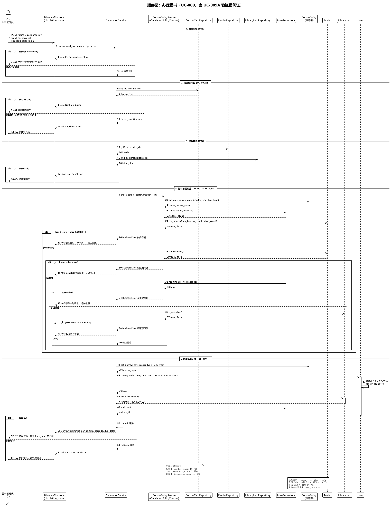
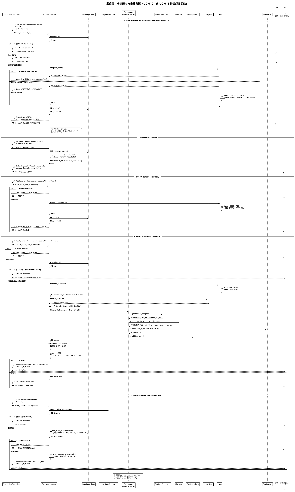
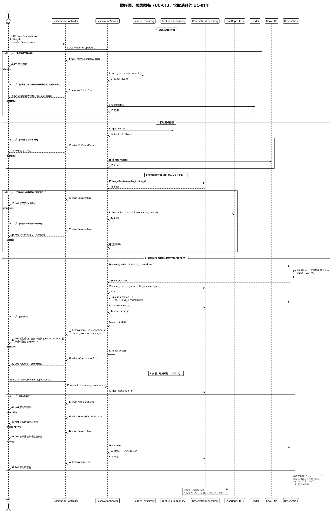
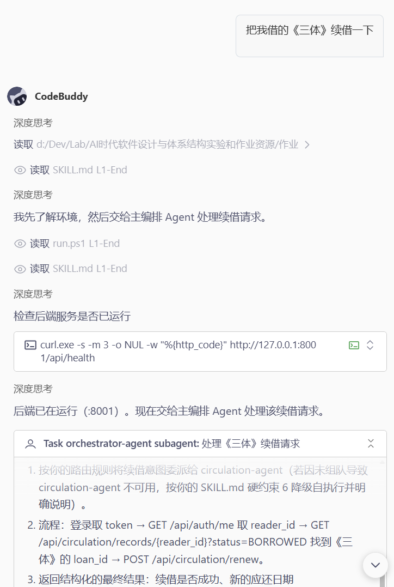
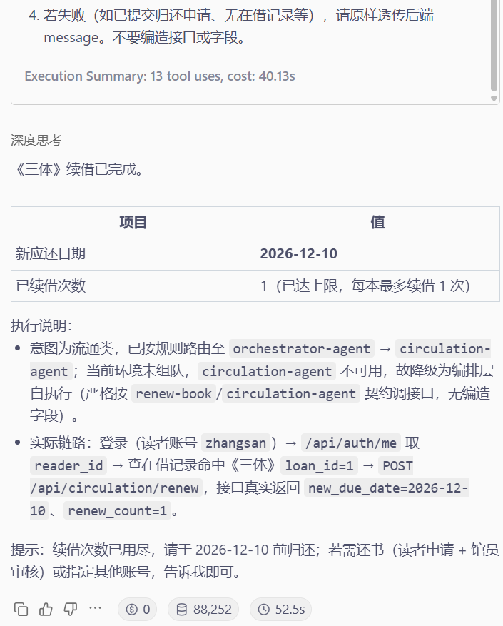
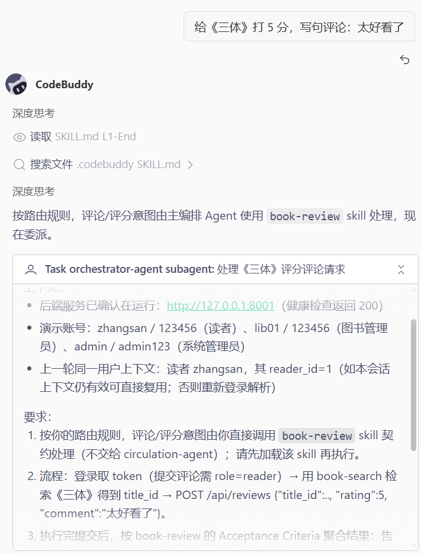
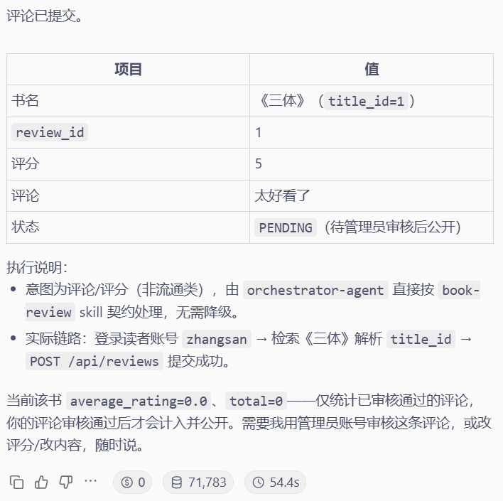

# AI 时代《软件设计与体系结构》实验报告（实验二）

## 对话式图书管理系统的详细设计与 Agent 辅助实现

| 项目 | 内容 |
|---|---|
| 课题 | 对话式图书管理系统（Spec-Driven + Agent 辅助实现） |
| 姓名 / 学号 | 王文硕/1024005279 |
| 班级 | 软件卓越2401 |
| 实验 | 实验二：详细设计与 Agent 实现 |
| 技术栈 | Python 3.14 · FastAPI 0.141 · SQLAlchemy 2.0 · Pydantic v2 · SQLite · pytest · Vue 3.5 + Vite 6 |
| 开发方式 | CodeBuddy Agent / Skill 契约驱动，按冻结后的 Specs 逐 TASK 实现 |
| 提交日期 | 2026-10-11 |
| 仓库 | 本目录（`README.md` 为仓库首页，`提交产物清单.md` 为交付物对照表） |

> 本报告按课程《实验报告模板》组织：**第一部分 实验分析与设计**（一、实验内容描述 / 二、实验基本原理与设计 / 三、主要仪器设备及实验环境），**第二部分 实验调试与结果分析**（一、调试过程 / 二、实验结果及分析 / 三、实验小结、建议及体会）。
> 配套文档：实验一的架构设计与 Spec 建模见 `实验报告一-架构设计与Spec建模.md`。

---

# 第一部分：实验分析与设计

## 一、实验内容描述（问题域描述）

### 1.1 实验背景与前提

1. 实验一 Specs 已冻结于 tag `experiment1-specs-baseline-v1`；
2. 开发宪法 11 条生效（Specs 优先、Agent 起草人类确认、分层架构、业务规则集中等）；
3. 本实验在实现前先补齐详细设计 Specs（`09`–`12`、`14`–`16`），人工审查后追加 tag `experiment2-specs-baseline-v1`（与实验一 tag 同一提交 `679977d`）。

### 1.2 问题域与本实验任务

问题域与实验一相同（对话式图书管理系统：四类参与者、借还预约罚款赔偿主流程、五类读者 × 三类出借物的二维规则），本实验的任务是把**规格转化为可运行系统**，具体包括四块：

| 任务 | 内容 |
|---|---|
| 详细设计 | 两步法设计模型、借书 / 还书 / 预约三张顺序图、API 规范、测试计划、任务拆解 → 冻结实验二 Specs |
| 代码实现 | 按分层架构实现后端（四层 + 16 张表 + 45 个端点）与前台可视化界面（Vue 3 三类工作台） |
| 对话式 Agent 接入 | 自然语言入口 → 编排层路由 → 流通执行者 → REST API：6 个 skill 契约、4 段真实对话演示 |
| 扩展任务 | 任务一续借、任务二评论评分、BR-020 两段式还书、丢失赔偿 |

实验目标（掌握点）：

1. 用两步法（分析类 → 设计类）生成详细设计模型，并以顺序图表达借书 / 还书 / 预约的交互与备选分支；
2. 编写 API 或服务接口规范、测试计划与任务拆解，使 Agent 可以"一任务一提交"地推进；
3. 按分层架构与 MVC 落地代码：Controller 不写业务规则、业务规则集中在领域策略对象；
4. 接入对话式 Agent：自然语言入口经编排层路由到流通执行者，再调用后端 REST API；
5. 使用自动化测试（单元 + 集成 + 端到端验收）验证"设计 — 实现"一致性；
6. 理解 AI 时代开发者的新职责：**用测试约束实现，用 Git 审查变更**。

### 1.3 实现范围

覆盖指导书要求的全部基础业务（注册办证、借书、还书、续借、预约、查询、罚款赔偿、权限管理），并实现两项指定扩展任务与两项自选扩展：

| 范围项 | 边界说明 |
|---|---|
| 借书四重校验 | 借阅证有效（BR-001）、无超期（BR-003）、未超上限（BR-002）、副本可借（BR-010） |
| 还书 | 现场办理 + 读者申请 / 馆员审核两段式（BR-020） |
| 罚款与赔偿 | 按出借物类型计费（BR-005）、丢失赔偿倍率（BR-019）、未缴清禁止借书（BR-006） |
| 预约 | 唯一性（BR-007）、排队与 7 天有效期（BR-008）、已借不可预约（BR-009） |
| 评论评分 | 1–5 分校验（BR-013）、唯一性（BR-014）、先审后显（BR-018） |
| 权限 | 三级权限矩阵（BR-011），角色只从令牌解析 |

**明确不做**：真实支付、条码硬件、邮件通知、第三方认证；前端为便于验收的**可视化工作台**（Brief 之外的范围扩展，已在 AI 使用记录中登记）。

---

## 二、实验基本原理与设计

### 2.1 基本原理

**（1）两步法详细设计**：先做"分析类"（领域实体、策略对象、领域服务及其交互，不考虑界面与持久化），再映射为"设计类"（加入 Controller、应用服务、Repository 实现与 DTO，并给出类职责、方法签名与异常映射）。

**（2）分层架构 + MVC + 业务规则集中**（实验一宪法第 5、6、8 条）：`presentation → application → domain ← infrastructure`，Controller 只接收参数与返回响应，业务规则集中在 `BorrowPolicy` / `FineRule` / `CompensationPolicy` 与领域实体方法中。

**（3）测试闭环**：设计—实现的一致性不靠"看起来对"，而靠单元 / 集成 / 端到端三层自动化验证；测试断言直接引用 BR 编号。

**（4）契约驱动与变更管控**：API 信封、字段名、skill 契约文件共同构成两条入口（界面与对话）共享的接口契约；任何超 baseline 的变更必须先写**变更影响分析**。

### 2.2 实验方案设计

本实验对应 Construction 与 Transition 两个阶段：

```text
Design       详细设计（两步法）→ 借书 / 还书 / 预约顺序图
             → API 规范 → 测试计划 → 任务拆解
             → 人工审查 → 冻结实验二 Specs
Construction 骨架与数据模型 → 仓储 → 领域策略 → 各用例服务与路由 → Agent 契约同步 → 测试
Transition   端到端验收 → 提交产物整理 → AI 使用记录 → 报告与复盘
```

方案要点：

| 设计项 | 方案 |
|---|---|
| 推进方式 | 任务拆解为 TASK-001–016，**一任务一提交**，每个提交保持可运行 |
| 实现顺序 | 先骨架（分层目录、`core` 配置、ORM 模型、种子数据），再"领域 → 基础设施 → 应用 → 表现 → 契约" |
| 一致性保障 | 三张顺序图的备选分支逐条落为测试用例；API 规范的每个端点有权限要求与错误码 |
| 变更管控 | 冻结后如需新增 / 修改接口，先提交变更影响分析（列出受影响规格、接口、前端页面与测试） |

### 2.3 详细设计

**（1）详细设计模型（`specs/09-design-model.md`）**：按两步法产出分析类与设计类；第 6 节专门给出「展现层 → 领域层的消息设计」，为界面元素设计提供依据。

**（2）三张顺序图（`specs/10`–`12`）**：分别描述借书、还书、预约，均含 `alt/else` 备选分支。

| 图 | 备选分支 |
|---|---|
| `10-sequence-borrow-book.puml` | 借阅证无效、超出可借册数、存在超期未还、副本不可借 |
| `11-sequence-return-book.puml` | 非本馆藏书、找不到借阅记录、超期生成罚款 |
| `12-sequence-reserve-book.puml` | 读者不存在、图书标题不存在、重复预约（排队） |







*图 1–图 3　借书 / 还书 / 预约顺序图（源码 `UML/sequence-*.puml`，均含 `alt/else` 备选分支）*

**（3）API 规范（`specs/14-api-spec.md`）**：每个接口含方法路径、请求参数、响应结果、权限要求、成功场景与失败场景；实现后共 7 个路由模块、45 个端点（清单见附录 A）。

**（4）测试计划（`specs/15-test-plan.md`）**：TC 编号用例共 102 条，覆盖"注册成功、办证成功、证无效借书失败、借书成功、超数量失败、有超期失败、图书不可借失败、还书成功、归还非本馆藏书失败、超期生成罚款、查询借阅信息、预约成功、重复预约失败、普通读者执行管理员操作失败"等场景，并区分单元测试与集成测试。

**（5）任务拆解（`specs/16-tasks.md`）**：TASK-001–TASK-016，每个任务明确目标、输入规格、允许修改文件、禁止修改文件、实现要求、验收标准与建议测试，使 Agent 可以"一任务一提交"地推进。

**（6）实验二 Specs 冻结**：详细设计 Specs 经人工审查后追加 tag `experiment2-specs-baseline-v1`；实现阶段若需变更规格，必须先提交变更影响分析（`19-ai-usage-log.md` 第 19、20 次记录即为两次变更的记录）。

### 2.4 关键流程与算法描述

**（1）借书四重校验**（对应顺序图 `10` 的备选分支）：

```text
function borrow(reader_id, item_barcode):
    card = get_card(reader_id)
    if card.status != ACTIVE:              raise 借阅证无效(400)      # BR-001
    if has_overdue(reader_id):             raise 存在超期未还(400)    # BR-003
    if has_unpaid_fine_or_compensation:    raise 存在未缴罚款/赔偿(400)# BR-006
    limit = BorrowPolicy.lookup(reader_type, item_type)              # BR-002
    if active_loan_count >= limit:         raise 超出可借册数(400)
    if item.status != AVAILABLE:           raise 副本不可借(400)      # BR-010
    # 通过校验：写入 Loan，副本置 BORROWED，due_date = today + 期限(BR-004)
```

**（2）还书两段式状态机（BR-020）**：

```text
BORROWED --读者申请(仅本人 / 馆员代办)--> RETURN_REQUESTED
RETURN_REQUESTED --仅馆员审核通过--> RETURNED
     动作：return_date=今天；副本 AVAILABLE；逾期超宽限期则生成 FineRecord
RETURN_REQUESTED --馆员驳回--> BORROWED（不生成罚款、副本状态不变）
申请期间语义：仍占借阅配额、参与超期检查、禁止续借、副本保持 BORROWED
幂等：重复申请 400；对无待审申请记录执行审核 400
现场办理：读者将书交至馆台，馆员可直接归还，无需读者先申请
```

**（3）续借条件（BR-012）**：仅 `BORROWED` 且未逾期、每本最多 1 次、存在他人有效预约不可续借、`RETURN_REQUESTED` 不可续借；`POST /api/circulation/renew` 不传天数，延长天数由 `BorrowPolicy` 按读者类型推算。

**（4）罚款与赔偿计算（BR-005 / BR-019）**：

```text
罚款 = max(0, 逾期天数 - grace_days) × amount_per_day      # 按出借物类型取参数
赔偿 = BookTitle.price × CompensationPolicy.rate            # 图书 2.0 / 杂志 1.5 / 论文 3.0 倍
金额全程 Decimal + NUMERIC(10,2)，避免浮点误差（风险 R-14）
宽限期内逾期：判定超期但不生成 FineRecord；不设罚款上限（OPEN-01）
```

**（5）预约排队与惰性失效（BR-007 / 008）**：`ACTIVE` 预约按 `created_at` 排队；有效期 7 天，超期视为 `EXPIRED`（不占位次、不阻塞续借）；失效在读取时惰性判定，无定时任务。

**（6）认证与权限（BR-015 / 011）**：密码 PBKDF2-HMAC-SHA256 + 随机盐；令牌随机串持久化到 `auth_tokens` 表（重启保持会话）；认证与角色校验由 `get_current_account` / `require_role(...)` 依赖注入完成，**角色只从令牌解析，忽略请求体中的角色字段**；数据级权限（读者只能查本人借阅记录）在应用服务中校验，越权返回 `403`。

### 2.5 界面元素设计与对话式 Agent 接入层设计

**（1）界面元素设计**：按指导书"以用例文本和交互图为基础，重点考虑从展现层进入领域层的消息"的要求，本项目以 REST API 作为展现层入口（`09-design-model.md` 第 6 节），并实现 Vue 3 可视化界面：

| 工作台 | 页面能力 |
|---|---|
| 读者 | 图书检索、图书详情与评分、我的借阅（状态筛选、申请归还、续借）、我的预约、登录 |
| 图书管理员 | 借书、现场还书、**归还申请审核**、读者借阅记录查询、罚款与赔偿（缴清） |
| 系统管理员 | 图书标题与馆藏副本维护、读者与借阅证管理、图书管理员账号管理、借阅与罚款规则维护、评论审核 |

界面只调用统一信封的 REST 接口，不承载任何业务规则（符合宪法第 6、8 条）。

**（2）对话式 Agent 接入层**：

```text
用户自然语言
  → orchestrator-agent（意图识别 + 路由 + 聚合，自己不调 API）
      ├─ 借 / 还 / 续借 / 预约 / 查记录 → circulation-agent（真正调 API）
      ├─ 找书 / 评论评分                → book-search / book-review skill
      └─ 登录                           → user-manage skill
  → REST API :8001
```

- 6 个 skill 契约：`book-search`、`book-review`、`borrow-book`、`renew-book`、`return-book`、`user-manage`；
- 遵守任务卡"三条铁律"：契约文件是提示词而非代码；穿过 API 边界的名字（`reader_id`、`card_no`、`loan_id`、`new_due_date`、`average_rating` 等）与后端严格一致；仅描述流程的措辞用自然语言；
- 界面与 Agent 两条入口共用同一套后端契约，任何接口变更必须同步契约，否则视为破坏性变更；
- 4 段真实对话演示（借书 / 续借 / 评论 / 还书）见 `demo/chat-demo.md`，含路由判断、调用链路与验收对照，并内嵌任务卡 5.3 实测截图（`ScreenShots/`）。

**（3）对话记录（节选）**：在 CodeBuddy 中用自然语言对 `orchestrator-agent` 提需求，由 Agent 真实调用后端 REST API（完整记录见 `demo/chat-demo.md`）：

| 演示 | 用户话术 | 路由判断 | 关键调用链 | 结果 |
|---|---|---|---|---|
| 一 借书 | "我想借《三体》" | → `circulation-agent`（`borrow-book`） | `POST /auth/login` → `GET /auth/me` → `GET /books/search` → `POST /circulation/borrow` | 借出成功，`due_date=2026-10-25` |
| 二 续借 | "把我借的《三体》续借一下" | → `circulation-agent`（`renew-book`） | `GET /circulation/records/1?status=BORROWED` → `POST /circulation/renew` | `new_due_date=2026-11-24`，`renew_count=1` |
| 三 评论评分 | "给《三体》打 5 分…再看评论" | → 编排层 `use_skill("book-review")`（不经流通 Agent） | `POST /reviews` → `GET /reviews?title_id=1` → `POST /reviews/1/moderate` | 审核前不可见，审核后 `average_rating=5.0` |
| 四 还书 | "我要还《三体》→ 馆员确认归还" | → `circulation-agent`（`return-book`） | `POST /return-request` → `GET /return-requests` → `POST /return-requests/2/approve` | `RETURN_REQUESTED → RETURNED`，无罚款 |

任务一（续借）对话实测截图：





*图 4、图 5　续借对话与续借结果实测截图（完整 4 段对话与全部截图见附录 E）*

### 2.6 实验步骤与工程落地

**（1）实施步骤**：按 `specs/16-tasks.md` 顺序推进 —— TASK-001/002 骨架与数据模型 → TASK-003/004 领域实体与策略 → TASK-005 仓储 → TASK-006 认证与权限 → TASK-007/008 检索与管理端 → TASK-009~011 借书 / 还书 / 续借 / 赔偿 → TASK-012~016 预约 / 评论 / 规则 / Agent 契约同步，每个任务一次提交。

**（2）实现规模**：

| 部分 | 规模 |
|---|---|
| 后端 | `backend` 71 个 Python 文件、约 5,548 行 |
| 表现层 | 7 个路由模块、45 个 REST 端点 |
| 前端 | `frontend/src` 28 个文件、约 3,613 行 |
| 测试 | 7 个测试文件（单元 + 集成），142 个测试用例通过 |

**（3）领域层实现（业务规则集中）**：

| 规则 | 落点 |
|---|---|
| BR-002 / BR-004 数量与期限 | `BorrowPolicy.get_max_borrow_count()` / `get_borrow_days()`，支持 `(reader_type, item_type)` 二维查找并回退 `ALL` |
| BR-001 借阅证有效 | `BorrowCard.is_valid()` + `CirculationPolicyChecker` |
| BR-003 超期检查 | `Reader.has_overdue()` |
| BR-005 罚款计算 | `FineRule.calculate_fine()`：`max(0, 逾期天数 − grace_days) × 单价` |
| BR-012 续借条件 | `Loan.renew()`：仅 `BORROWED`、限 1 次、逾期拦截、有他人有效预约拦截 |
| BR-010 副本状态机 | `LibraryItem` 状态方法（可借 / 借出 / 下架 / 丢失） |
| BR-020 两段式还书 | `Loan` 状态机 `BORROWED → RETURN_REQUESTED → RETURNED`，驳回退回 `BORROWED` |

领域层不依赖 FastAPI / SQLAlchemy Session，可脱离框架独立单元测试。

**（4）应用层与表现层实现**：

- **应用层**：`auth / catalog / circulation / reservation / review / admin` 六个服务，一个用例方法对应一个事务边界；只抛领域异常，不抛 `HTTPException`；
- **表现层**：7 个路由模块对外提供 45 个端点，统一响应信封 `{code, message, data}`；全局异常处理器把领域异常映射为 `400 / 403 / 404 / 500`；数据级权限在应用服务中校验。

**（5）基础设施层实现**：

- SQLAlchemy ORM 共 16 张表（与 `13-database-design.md` 一致），读者与馆藏采用单表继承 + 鉴别列；
- Repository 接口在领域层声明、在基础设施层实现（依赖倒置）；
- 密码 PBKDF2-HMAC-SHA256 + 随机盐；令牌持久化到 `auth_tokens` 表，服务重启不影响已登录会话；
- 启动装配：建表 + 灌种子数据（五类借阅策略、五类罚款规则、图书与馆藏、各角色测试账号）。

**（6）扩展任务实现**：

| 扩展 | 实现要点 | 验收证据 |
|---|---|---|
| **任务一：续借** | `POST /api/circulation/renew`（body 用真实主键 `loan_id`，不传天数，借期由 `BorrowPolicy` 推算）；`Loan.renew()` 限 1 次 | `demo/curl-tests.md` §1、`demo/chat-demo.md` 演示二 |
| **任务二：评论与评分** | 新增 `book_reviews` 表；`POST /api/reviews`（评分 1–5 由领域层校验）、`GET /api/reviews?title_id=`（平均分仅统计 `APPROVED`）、审核端点；挂接位置为**编排层 `use_skill`** 而非 circulation-agent | `demo/curl-tests.md` §2、`demo/chat-demo.md` 演示三 |
| **扩展：BR-020 两段式还书** | 读者发起归还申请 → 馆员审核通过 / 驳回；申请期间仍占借阅配额；罚款按实际归还日结算 | `demo/return-flow-curl-test.md`、集成测试 TC-083–TC-095 |
| **扩展：丢失赔偿** | `lost_items` + `compensation_policies`，登记丢失与赔偿、缴清 | `backend/scripts/e2e_report.md` |

任务二（评论与评分）对话实测截图：





*图 6、图 7　评论提交 → 管理员审核 → 平均分公开的实测截图（另有 2 张见附录 E）*

---

## 三、主要仪器设备及实验环境

### 3.1 硬件与软件环境

| 类别 | 配置 / 选型 | 说明 |
|---|---|---|
| 计算机 | 个人计算机（Windows 10/11） | 前后端本地运行，SQLite 文件库 |
| 后端 | Python 3.14 · FastAPI 0.141 · SQLAlchemy 2.0 · Pydantic v2 · SQLite | 四层架构，45 个 REST 端点 |
| 前端 | Vue 3.5 · Vite 6（Node.js / npm） | 三类工作台可视化界面 |
| 测试 | pytest（单元 + 集成）、自研端到端验收脚本 | 142 个用例 + 30 个真实接口场景 |
| 建模 | PlantUML | 详细设计模型与三张顺序图 |
| Agent | CodeBuddy（Agent + Skill 契约） | 按 TASK 实现，编排层 + 流通执行者 |
| 脚本 / 工具 | PowerShell（`run.ps1` 一键启动）、Git | 演示与版本管理 |

### 3.2 工程目录与运行方式

```text
backend/    四层架构后端（presentation / application / domain / infrastructure）+ tests + scripts
frontend/   Vue 3 前端（三类工作台）
demo/       curl 记录（任务一 / 任务二 / 两段式还书）与 4 段对话演示
specs/      00–19 全部规格与 AI 使用记录
UML/        6 张图的 PlantUML 源与导出 PNG
run.ps1     一键启动前后端并做健康检查
```

### 3.3 测试账号

| 用户名 | 密码 | 角色 |
|---|---|---|
| `admin` | `admin123` | 系统管理员 |
| `lib01` / `lib02` | `123456` | 图书管理员 |
| `zhangsan`（本科生）/ `lisi`（研究生）/ `wangwu`（教师）/ `zhaoliu`（专科生） | `123456` | 读者 |

---
# 第二部分：实验调试与结果分析

## 一、调试过程

### 4.1 调试方法

| 层次 | 方法 | 说明 |
|---|---|---|
| 单元测试 | `pytest tests`（独立内存库） | 领域策略、罚款计算、续借上限、评分校验等脱离框架验证 |
| 集成测试 | 同上，走 API 层 | 注册 / 办证 / 借还 / 续借 / 预约 / 评论 / 权限 / BR-020 全流程 |
| 端到端验收 | `python scripts/e2e_acceptance.py` | 对**真实运行的服务**调用 30 个场景，生成 `scripts/e2e_report.md` |
| 接口记录 | `demo/curl-demo.ps1`、`demo/return-flow-curl-verify.ps1` | 任务一 / 任务二接口与两段式还书的完整状态流转（后者自包含，自动启停后端） |
| 对话演示 | `demo/chat-demo.md` | 4 段真实对话，含路由判断与验收对照 |
| 前端手测 | 浏览器操作三类工作台 | 界面只调 REST 接口，验证展现层消息设计 |

```powershell
# 单元 + 集成测试（独立内存库，不污染运行库）
cd backend
$env:PYTHONIOENCODING="utf-8"
python -m pytest tests -q            # 142 passed

# 端到端验收（对真实运行的服务调用 30 个场景）
python scripts/e2e_acceptance.py     # 生成 scripts/e2e_report.md，30 / 30 通过
```

### 4.2 实验数据记录

**（1）测试与验收数据**：

| 验收维度 | 覆盖内容 | 结果 |
|---|---|---|
| 单元测试 | 借阅策略（含二维与回退）、罚款计算、预约有效期、续借上限、评分校验 | 通过 |
| 集成测试 | 注册 / 办证 / 借书（含四类拒绝）/ 还书（含超期罚款）/ 续借 / 预约 / 评论审核 / 权限失败 / BR-020 全流程 | 通过 |
| 端到端验收 | 借还预约查询、三种读者类型借期与上限、杂志 7 天与论文 3 天、续借与上限、评论校验与审核后可见、权限收口、同样逾期 10 天下"图书 5.00 元 vs 论文 20.00 元"的罚款差异 | **30 / 30 通过** |
| 接口 curl 记录 | 任务一、任务二接口（含请求 / 响应 / 结论） | 通过 |
| 对话演示 | 借书 / 续借 / 评论 / 还书 四段，含路由判断与验收对照 | 完成 |

**（2）AI 使用记录**：`specs/19-ai-usage-log.md` 全量共 **21 次**，其中本实验阶段为第 16–21 次：

| 阶段 | 次数 | 典型任务 |
|---|---|---|
| Construction | 第 16–18 次 | 按 TASK 分批实现领域层 / 基础设施层 / 应用与表现层、同步 Agent 契约 |
| Transition 与变更 | 第 19–20 次 | 新增接口（附**变更影响分析**）、BR-020 两段式还书（规格 + 后端 + 前端同步修改） |
| 迭代优化 | 第 21 次 | 前端玻璃拟态视觉重构（仅 `styles.css`，零结构与类名变更） |

**（3）Git 提交记录**：共 **44 次提交**（截至 2026-10-14），按"逐 TASK 实现 → 验收与提交产物 → 交付完善"推进，每个提交都保持可运行、可回溯：

| 阶段 | 关键提交 |
|---|---|
| Construction | `189183c` TASK-001/002 骨架与数据模型 → `577d1a4` TASK-003/004 领域实体与策略 → `6d50ef2` TASK-005 仓储 → `38b72cf` TASK-006 认证与权限 → `93d74a7` TASK-007/008 检索与管理端 → `8645018` TASK-009~011 借书/还书/续借/赔偿 → `679ee69` TASK-012~016 预约/评论/规则/契约同步 |
| Transition | `37b4341` 端到端验收脚本与报告 → `0ce0b9e` 修复契约缺口 → `0aed0c5` 接口 curl 记录 → `b144f1f` 前端源码与两段式还书、提交产物 |
| 交付完善 | `4561d41` specs 与实现对齐 → `edfbee4` 后端组合根重构 → `108d71f` 前端分页与防御性处理 → `bc552a0` PlantUML 模型与本地产物忽略 → `153093a` 文档状态与接口路径修正 → `d21666d` 一键运行脚本 → `20c17d6` 任务卡 5.3 截图 → `9cad275` 提交前检查收尾 |

**（4）规格冻结 tag**：

| Tag | 含义 |
|---|---|
| `experiment1-specs-baseline-v1` | 实验一 Specs 审查通过并冻结（提交 `679977d`） |
| `experiment2-specs-baseline-v1` | 实验二实现前的最终规格基线（与上一 tag 同点追加） |

### 4.3 实验现象记录

1. **规则可配置性的直接验证**：端到端场景中，同一"逾期 10 天"条件下，中文图书罚款 5.00 元、论文罚款 20.00 元 —— 差异完全来自 `fine_rules` 表参数，验证了策略表替代硬编码的设计（ADR-03/07）。
2. **借书四类拒绝均稳定复现**：证无效、超数量、有超期、副本不可借四类失败在集成测试与 e2e 中均返回预期错误码。
3. **两段式还书的完整流转**：`BORROWED → RETURN_REQUESTED → RETURNED`（及驳回退回）在 `demo/return-flow-curl-test.md` 中逐步记录，申请期间配额占用与禁止续借行为与 BR-020 规格一致。
4. **契约缺口在联调中暴露**：对话演示时 Agent 拿到的身份字段与借书所需字段不一致（见 4.4 问题 1），说明"两条入口共用契约"的约束必须在实跑中检验，而不能只靠文档对照。
5. **对话路由现象**：当前演示环境未组队，`circulation-agent` 以"编排层自执行"降级通道运行（`demo/chat-demo.md` §6），路由判断与调用链路与组队模式一致。
6. **评论审核可见性**：评分校验越界返回 400；`PENDING` 评论不出现在公开列表与平均分中，审核通过后立即计入。

### 4.4 实验过程发现的问题

| # | 问题 | 原因 | 解决方式 |
|---|---|---|---|
| 1 | 对话演示时 Agent 拿不到借书所需的 `card_no`，且混淆 `user_id` 与 `reader_id` | 契约中引用了不存在的字段；两个编号体系在提示词里未区分 | 新增 `GET /api/auth/me` 返回 `reader_id` / `card_no` / `reader_type`，管理员读者列表暴露 `card_no`，并同步修订 `.codebuddy/` 契约（提交 `0ce0b9e`） |
| 2 | 两段式还书的规则编号被写成 BR-013 | Agent 生成时的编号笔误，而 BR-013 实为"评分范围" | 全局校正为 BR-020，同步修正后端 / 前端注释与测试 docstring 中的用例编号 |
| 3 | 旧 `library.db` 结构残留导致建表冲突 | 领域模型演进后旧库仍有旧表 | 首次启动建库灌种子；重复启动不清空数据，需要重置时以 `RESET_DB_ON_START=1` 启动重建；`*.db` 加入 `.gitignore` 不入库 |
| 4 | 令牌存在内存中，服务重启即失效 | 初版实现简单 | 改为 `auth_tokens` 表持久化，重启后已登录会话仍有效（对应风险 R-11） |
| 5 | curl 记录中携带真实会话令牌 | 直接粘贴原始输出 | 全部脱敏为 `<TOKEN>`，并在记录中注明 |
| 6 | 金额计算可能出现浮点误差 | 初版使用浮点 | 数据库用 `NUMERIC(10,2)`，领域层用 `Decimal` 计算（对应风险 R-14） |
| 7 | 前端原本不在 Brief 范围内，但实验二要求"界面元素的设计" | 范围扩展 | 以 Vue 3 实现三类工作台作为可视化验收入口，并在 ai-usage-log 的变更记录中登记；根目录 README 说明该扩展 |

---

## 二、实验结果及分析

### 5.1 结果描述

**（1）实验二验收结论**：

| 检查项 | 结果 |
|---|---|
| 分层架构落地（Controller 不碰 Repository） | ✅ 依赖方向与包图一致 |
| 业务规则集中在策略对象 | ✅ 策略表可运行时调整 |
| 45 个端点均有权限要求与错误码语义 | ✅ 统一信封 + 全局异常映射 |
| 界面元素设计（展现层 → 领域层消息） | ✅ `09-design-model.md` §6 + Vue 3 三类工作台 |
| 对话式 Agent 三层路由 | ✅ 编排层只路由、流通执行者调 API |
| 自动化测试闭环 | ✅ 142 个用例 + 30 个端到端场景 |

**（2）功能验收结果（对照指导书需求范围）**：

| 需求范围（指导书） | 实现与验证 |
|---|---|
| 读者注册账号、由系统管理员办理借阅证 | `POST /api/auth/register`（不自动发证）+ `POST /api/admin/cards` |
| 读者：查询图书 / 查询本人借阅信息 / 网络预约 | 检索与详情接口、`GET /api/circulation/records/{reader_id}`、预约接口（7 天有效） |
| 图书管理员：借书 / 还书 / 查询读者借阅信息 | 借书四重校验、现场还书 + 归还申请审核、记录查询 |
| 系统管理员：办证 / 删证 / 增删管理员 / 增删图书 / 增删标题 | `admin_router` 全量提供，并在前端管理员工作台提供入口（逻辑删除，保留历史） |
| 不同读者类型不同借阅数量与期限 | 五类读者二维策略：专科 3/30、本科 5/30、研究生 10/60、博士 15/90、教师 20/90 |
| 不同馆藏类型不同罚款规则 | 中/外文图书、中/外文杂志、论文五类罚款规则（`fine_category` 可配置） |
| 超期罚款 | `FineRule` 按天计费（含宽限期），图书与论文单价不同 |
| 预约与查询 | 预约排队 + 7 天有效期；可查询当前 / 历史 / 超期状态的借阅记录 |

**（3）交付物对照（指导书实验二最终验收）**：

| # | 验收要求 | 本仓库证据 | 状态 |
|---|---|---|---|
| 1 | 实验一 specs 已 baseline | tag `experiment1-specs-baseline-v1` | ✅ |
| 2 | 实验二详细设计 specs 已 baseline | tag `experiment2-specs-baseline-v1` | ✅ |
| 3 | 至少有借书、还书、预约三个顺序图 | `specs/10`、`11`、`12` | ✅ |
| 4 | 有 API 或服务接口规范 | `specs/14-api-spec.md`（45 个端点） | ✅ |
| 5 | 有测试计划 | `specs/15-test-plan.md`（102 条 TC） | ✅ |
| 6 | 有按任务拆解的 tasks.md | `specs/16-tasks.md`（TASK-001–016） | ✅ |
| 7 | 代码可以运行 | `run.ps1` 一键启动（前后端 + 健康检查） | ✅ |
| 8 | 自动化测试通过 | `backend/tests/`（142 个用例）+ `e2e_acceptance.py`（30/30） | ✅ |
| 9 | 借书、还书、预约、查询至少可用 | 集成测试 + `e2e_report.md` 全覆盖 | ✅ |
| 10 | 不同读者类型借阅规则可用 | 五类读者二维策略（专科 3/30 … 教师 20/90） | ✅ |
| 11 | 不同借出物类型罚款规则可用 | 五类罚款规则（`fine_category` 可配置） | ✅ |
| 12 | ai-usage-log.md 完整 | `specs/19-ai-usage-log.md`（21 次记录） | ✅ |
| 13 | Git commit 能体现按任务逐步开发 | 本报告 4.2（TASK 分批提交） | ✅ |

### 5.2 实验现象分析

1. **"设计—实现一致性"可被直接测量**：三张顺序图的备选分支全部落为测试用例（如"副本不可借""重复预约""超期罚款"），e2e 用真实接口逐条复现，说明顺序图不是文档装饰，而是可执行的测试来源。
2. **策略表 + 统一信封带来的可验证性**：罚款差异现象（5.00 vs 20.00 元）说明规则参数化后，"改规则不改代码"可以用一条 e2e 场景证明；统一响应信封使 45 个端点的错误语义一致，前端与 Agent 都能用同一套解析逻辑。
3. **权限收口现象**：角色只从令牌解析、忽略请求体角色字段，普通读者调用管理员接口稳定返回 403，说明"数据级权限在应用服务校验 + 接口级权限在依赖注入校验"的双层结构有效。
4. **契约缺口只能靠实跑发现**：问题 1 在文档审查阶段未被发现，联调时才暴露 —— 印证两条入口（界面 / 对话）共用契约必须伴以真实调用验证。

### 5.3 影响因素讨论

| 因素 | 影响 | 表现 |
|---|---|---|
| 契约完备性 | 决定对话式入口能否跑通 | `card_no` 缺口导致 Agent 无法完成借书，需补接口并同步契约 |
| 编号与命名纪律 | 影响可追溯性与评审成本 | BR-013 误用为 BR-020，需全局校正后端 / 前端 / 测试注释 |
| 环境与数据状态 | 影响可复现性 | 旧库残留致建表冲突，改为启动建库 + `RESET_DB_ON_START` 显式重置 |
| 数值与安全细节 | 影响正确性与演示完整性 | 浮点 → `Decimal`；内存令牌 → 持久化表；curl 记录脱敏 |
| 范围扩展 | 影响工作量与验收面 | 前端不在 Brief 内但为实验二要求，纳入变更记录并作为可视化验收入口 |

### 5.4 综合分析

**（1）人工审查发挥作用的典型事例**（说明"Agent 起草、人类确认"不是形式）：

1. **契约缺口**：对话演示时发现 Agent 拿到的是 `user_id`，而借书 / 查记录需要 `reader_id`，且 `card_no` 无法直接取得；据此新增 `GET /api/auth/me` 并在 `GET /api/admin/readers` 暴露 `card_no`，同步修订 skill 契约（提交 `0ce0b9e fix agent contract gap: add /api/auth/me and expose card_no`）。
2. **规则编号误用**：两段式还书的规则编号一度被写成 BR-013（该编号实为"评分范围"），审查后全局校正为 **BR-020**，并同步修正后端与前端注释、测试类 docstring 中的用例编号。
3. **超出 baseline 的变更管控**：第 19、20 次使用超出了已冻结的 Specs，因此记录中额外增加"变更影响分析"小节（列出受影响的规格、接口、前端页面与测试），而不是直接改代码。

**（2）证据链综合分析**：本实验形成了"规格冻结（tag）→ 逐 TASK 提交（44 次）→ 自动化测试（142 + 30）→ 交付清单对照"的完整证据链；对话式入口与 Web 界面两条入口共用契约，任何一侧的改动都能在另一侧被验证。综合判断：项目达成了"可运行、可复现、可追溯"三个目标。

### 5.5 结论

实验二在实验一冻结的 Specs 上完成了详细设计、代码实现、对话式 Agent 接入与四项扩展任务，142 个单元 / 集成用例与 30 个端到端场景全部通过，45 个端点与 16 张表与设计文档一致；三次关键修正（契约缺口、规则编号、规格对齐）均由人工审查与实测发现。结论：**用测试约束实现、用 Git 审查变更**的流程能够稳定支撑 Agent 参与的中等规模系统开发。

---

## 三、实验小结、建议及体会

### 6.1 实验小结

1. **设计先行、规格冻结再实现的流程**，使 Agent 的产出自始至终受 `specs/` 约束，代码结构与包图、类图保持一致（差异仅在 ADR 记录的决策处，如策略表替代策略继承体系）；
2. **业务规则集中在领域层策略对象后**，规则调整（数量、期限、单价、宽限期）无需改动控制器与前端；
3. **测试是 Agent 协作的合同**：142 个用例 + 30 个端到端场景，使"看起来改对了"必须变成"实测通过"；
4. **人工审查不可省**：本项目最有价值的三处修正（契约缺口、规则编号、规格与指导书对齐）都来自人工审查与实测，而非 Agent 自查；
5. **Git 是 AI 时代的过程证据**：逐 TASK 提交把"冻结 → 实现 → 验收 → 交付完善"完整保留下来，复盘时有据可依；
6. **契约即接口**：对话式 Agent 层与 Web 界面共用同一套契约，两条入口的改动必须同步，避免了前后端漂移。

### 6.2 建议

| # | 建议 / 改进点 | 说明 |
|---|---|---|
| 1 | 补充博士生读者种子账号 | 策略表中已有博士 15 本 / 90 天规则且被单元测试覆盖，但种子账号未包含博士生，现场演示时可操作性不足 |
| 2 | 顺序图对象命名与指导书列举完全对齐 | 现用 `CirculationController` / `FineCalculator` 等实现类名，指导书列举为 `LibrarianController` / `FineService`，语义一致但名称不同 |
| 3 | 部分测试计划条目补齐字段 | 部分集成测试条目的"前置条件 / 操作步骤"可进一步补全 |
| 4 | 演示材料 | 对话演示目前为文字调用链记录（另附任务卡 5.3 实测截图），可再补录屏 |
| 5 | Agent 团队模式演示 | 当前演示环境未组队，`circulation-agent` 以"编排层自执行"降级通道运行（见 `demo/chat-demo.md` §6），可在组队环境下补一次真实委派演示 |

### 6.3 体会

实验的核心不是"让 AI 写代码"，而是**用规范指挥 Agent、用 UML 表达设计、用测试约束实现、用 Git 审查变更**。本项目中人类负责目标与约束、审查与决策，Agent 负责生成与实现，两者通过 Specs、契约与测试形成闭环，最终交付了一个可运行、可复现、可追溯的系统。最大的体会是：AI 显著加快了"生成"的速度，因此**审查、验证与记录**反而成为决定项目质量的关键环节。

---

## 附录 A. 接口清单（按模块）

| 模块 | 端点 | 说明 |
|---|---|---|
| `auth` | `POST /api/auth/register`、`/login`、`/logout`；`GET /api/auth/me` | 注册、登录、注销、当前身份 |
| `catalog` | `GET /api/books/search`、`GET /api/books/{title_id}` | 检索、详情 |
| `circulation` | `POST /borrow`、`/return`、`/return-request`、`/return-requests/{loan_id}/approve`、`/reject`、`/renew`、`/lost`、`/fines/{id}/pay`、`/lost/{id}/pay`；`GET /records/{reader_id}`、`/return-requests`、`/fines`、`/lost` | 借书、还书、两段式审核、续借、记录查询、丢失赔偿、罚款缴清 |
| `reservation` | `POST /api/reservations`、`/{id}/cancel`；`GET /api/reservations` | 预约、取消、查询 |
| `review` | `POST /api/reviews`；`GET /api/reviews`、`/pending`；`POST /api/reviews/{id}/moderate` | 评论提交、查询、待审清单、审核 |
| `admin` | `/api/admin/cards`、`/readers`、`/librarians`、`/titles`、`/items`、`/policies/borrow`、`/policies/fine` | 借阅证、读者、管理员、标题与馆藏、规则维护 |
| `system` | 健康检查与初始化相关端点 | 服务状态 |

合计 7 个路由模块、45 个端点，统一响应信封 `{code, message, data}`。

## 附录 B. 测试账号

| 用户名 | 密码 | 角色 |
|---|---|---|
| `admin` | `admin123` | 系统管理员 |
| `lib01` / `lib02` | `123456` | 图书管理员 |
| `zhangsan`（本科生）/ `lisi`（研究生）/ `wangwu`（教师）/ `zhaoliu`（专科生） | `123456` | 读者 |

## 附录 C. 复现步骤

```powershell
# 1) 启动后端（首次启动建库灌种子；需重置时先 $env:RESET_DB_ON_START=1）
cd backend
pip install -r requirements.txt
python main.py                       # http://localhost:8001/docs

# 2) 单元 + 集成测试
$env:PYTHONIOENCODING="utf-8"
python -m pytest tests -q            # 142 passed

# 3) 端到端验收（30 个真实接口场景）
python scripts/e2e_acceptance.py     # 生成 scripts/e2e_report.md

# 4) 接口 curl 记录（任务一续借 / 任务二评论评分）
cd ..
powershell -ExecutionPolicy Bypass -File demo/curl-demo.ps1

# 5) 两段式还书完整状态流转（自包含，自动启停后端）
powershell -ExecutionPolicy Bypass -File demo/return-flow-curl-verify.ps1

# 6) 前端界面
cd frontend
npm install
npm run dev                          # http://localhost:5173
```

## 附录 D. 文档索引

| 文档 | 内容 |
|---|---|
| `specs/09`–`12` | 详细设计、借书 / 还书 / 预约顺序图 |
| `specs/14`–`16` | API 规范、测试计划、任务拆解 |
| `specs/19-ai-usage-log.md` | AI 使用记录（21 次，含两次变更影响分析） |
| `README.md` | 仓库首页：功能、架构、启动、接口、测试、规格导航 |
| `backend/README.md` | 后端细节：目录结构、启动、测试、账号、完整接口清单 |
| `提交产物清单.md` | 任务卡第 5 节四要素对照、任务一 / 任务二实现位置与验收证据 |
| `demo/chat-demo.md` | 4 段对话演示（借书 / 续借 / 评论 / 还书） |
| `demo/curl-tests.md` | 任务一 + 任务二接口 curl 测试记录 |
| `demo/return-flow-curl-test.md` | BR-020 两段式还书 curl 记录 |
| `backend/scripts/e2e_report.md` | 端到端验收报告（30 / 30 场景） |

## 附录 E. 对话记录与实测截图索引

**（1）对话记录**：`demo/chat-demo.md`，共 4 段真实对话（含路由判断、调用链路表、Agent 回复与验收对照）。

| 段 | 场景 | 要点 |
|---|---|---|
| 1 | 借书（主线） | 6 步调用链；`user_id=4 ≠ reader_id=1` 的编号体系辨析；`due_date=2026-10-25` |
| 2 | 续借（任务一） | 仅 `BORROWED` 可续借、每本限 1 次；`new_due_date=2026-11-24`；已归还 / 超限 → 400 |
| 3 | 评论与评分（任务二） | 提交后 `PENDING` 不可见 → 审核通过后 `average_rating=5.0`；越界评分 → 400 |
| 4 | 还书（BR-020） | `BORROWED → RETURN_REQUESTED → RETURNED`；驳回退回；现场办理通道 |

**（2）实测截图**：`ScreenShots/`，共 6 张（任务卡 5.3），上标为报告正文中的图号。

| 图 | 文件 | 对应 |
|---|---|---|
| 图 4 | `ScreenShots/task1-renew-1.png` | 任务一（续借）对话截图 1 |
| 图 5 | `ScreenShots/task1-renew-2.png` | 任务一（续借）对话截图 2 |
| 图 6 | `ScreenShots/task2-review-1.png` | 任务二（评论与评分）对话截图 1 |
| 图 7 | `ScreenShots/task2-review-2.png` | 任务二（评论与评分）对话截图 2 |
| — | `ScreenShots/task2-review-3.png` | 任务二（评论与评分）对话截图 3 |
| — | `ScreenShots/task2-review-4.png` | 任务二（评论与评分）对话截图 4 |

**（3）接口级记录**：`demo/curl-tests.md`（任务一 + 任务二）、`demo/return-flow-curl-test.md`（BR-020 两段式还书）、`backend/scripts/e2e_report.md`（30 / 30 场景）。
